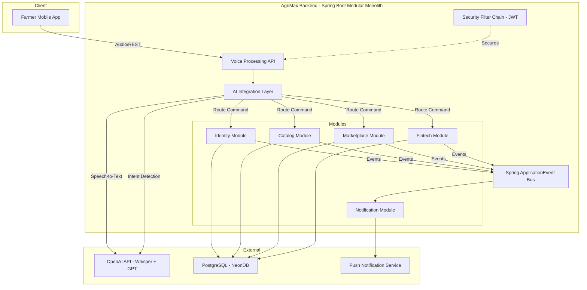
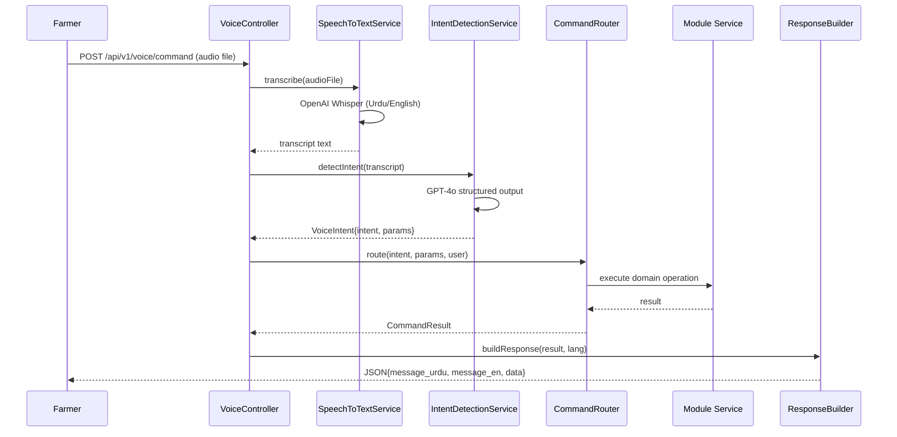
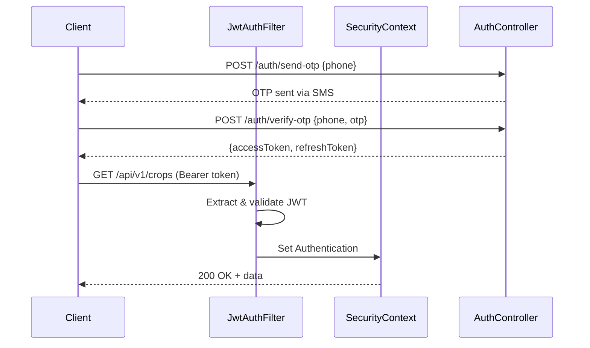

# AgriMax — AI-First Agricultural Platform

> **Goal**: Build a production-grade, voice-first, multilingual (Urdu + English) platform for farmers. The system uses AI/NLP to convert voice commands into structured backend operations.

---

## High-Level Design (HLD)

### System Overview



### Key Architecture Decisions

| Decision | Choice | Rationale |
|---|---|---|
| Backend | Spring Boot 3.3+ | Mature, production-proven, excellent AI support via Spring AI |
| Architecture | Modular Monolith | Simpler ops for startup; modules can be extracted later |
| AI Framework | Spring AI + OpenAI | Whisper for STT, GPT-4o for intent detection |
| Database | PostgreSQL (NeonDB) | Schema-per-module isolation on shared DB |
| Auth | JWT + OncePerRequestFilter | Stateless, mobile-friendly |
| Inter-module | Spring ApplicationEvent | Decoupled, no direct module calls |
| Build Tool | Maven (multi-module) | Clear module boundaries |

### Module Responsibility Matrix

| Module | Schema | Responsibilities |
|---|---|---|
| **Identity** | `identity.*` | User registration, OTP login, JWT, KYC, roles |
| **Catalog** | `catalog.*` | Crops master data, prices, AI price insights |
| **Marketplace** | `marketplace.*` | Sell posts, bids, deals, order lifecycle |
| **Fintech** | `fintech.*` | Wallet, escrow, payment transactions |
| **Notification** | `notification.*` | Push, SMS, voice response delivery |
| **AI (cross-cutting)** | — | Voice processing, intent detection, command routing |

---

## Low-Level Design (LLD)

### Voice Processing Pipeline



### Intent Detection — AI Prompt Design

**System Prompt** (sent to GPT-4o):
```
You are an intent detection engine for an agricultural marketplace.
Given a farmer's spoken text (Urdu or English), extract:
1. intent — one of: LOGIN, CREATE_SELL_POST, GET_CROP_PRICE, VIEW_PAYMENTS, 
   VIEW_WALLET, PLACE_BID, CHECK_ORDER_STATUS, GET_RECOMMENDATION
2. parameters — a JSON object with relevant fields (crop, quantity, unit, price, etc.)
3. language — "ur" or "en"
4. confidence — 0.0 to 1.0

Respond ONLY with valid JSON matching this schema.
```

**Example I/O**:
- Input: `"Mujhe 50 kilo gehu 3000 mein bechna hai"`
- Output:
```json
{
  "intent": "CREATE_SELL_POST",
  "parameters": { "crop": "wheat", "quantity": 50, "unit": "kg", "price": 3000 },
  "language": "ur",
  "confidence": 0.95
}
```

---

## Database Schema Design

### Identity Schema (`identity`)

```sql
CREATE SCHEMA IF NOT EXISTS identity;

CREATE TABLE identity.users (
    id              UUID PRIMARY KEY DEFAULT gen_random_uuid(),
    phone_number    VARCHAR(15) NOT NULL UNIQUE,
    name            VARCHAR(100),
    role            VARCHAR(20) NOT NULL DEFAULT 'FARMER', -- FARMER, BUYER, ADMIN
    language_pref   VARCHAR(5) DEFAULT 'ur',
    is_kyc_verified BOOLEAN DEFAULT FALSE,
    profile_image   TEXT,
    created_at      TIMESTAMPTZ DEFAULT NOW(),
    updated_at      TIMESTAMPTZ DEFAULT NOW()
);

CREATE TABLE identity.otp_tokens (
    id          UUID PRIMARY KEY DEFAULT gen_random_uuid(),
    user_id     UUID REFERENCES identity.users(id),
    otp_code    VARCHAR(6) NOT NULL,
    expires_at  TIMESTAMPTZ NOT NULL,
    verified    BOOLEAN DEFAULT FALSE,
    created_at  TIMESTAMPTZ DEFAULT NOW()
);

CREATE TABLE identity.kyc_documents (
    id          UUID PRIMARY KEY DEFAULT gen_random_uuid(),
    user_id     UUID REFERENCES identity.users(id),
    doc_type    VARCHAR(30) NOT NULL, -- CNIC_FRONT, CNIC_BACK, LAND_RECORD
    doc_url     TEXT NOT NULL,
    status      VARCHAR(20) DEFAULT 'PENDING', -- PENDING, APPROVED, REJECTED
    created_at  TIMESTAMPTZ DEFAULT NOW()
);
```

### Catalog Schema (`catalog`)

```sql
CREATE SCHEMA IF NOT EXISTS catalog;

CREATE TABLE catalog.crops (
    id          UUID PRIMARY KEY DEFAULT gen_random_uuid(),
    name_en     VARCHAR(100) NOT NULL,
    name_ur     VARCHAR(100) NOT NULL,
    category    VARCHAR(50),
    unit        VARCHAR(20) DEFAULT 'kg',
    image_url   TEXT,
    is_active   BOOLEAN DEFAULT TRUE,
    created_at  TIMESTAMPTZ DEFAULT NOW()
);

CREATE TABLE catalog.crop_prices (
    id          UUID PRIMARY KEY DEFAULT gen_random_uuid(),
    crop_id     UUID REFERENCES catalog.crops(id),
    market_name VARCHAR(100),
    min_price   DECIMAL(12,2),
    max_price   DECIMAL(12,2),
    avg_price   DECIMAL(12,2),
    source      VARCHAR(50), -- MANUAL, AI_PREDICTED, GOVT_API
    price_date  DATE NOT NULL,
    created_at  TIMESTAMPTZ DEFAULT NOW()
);

CREATE TABLE catalog.ai_insights (
    id          UUID PRIMARY KEY DEFAULT gen_random_uuid(),
    crop_id     UUID REFERENCES catalog.crops(id),
    insight_type VARCHAR(30), -- PRICE_PREDICTION, DEMAND_FORECAST, SELL_RECOMMENDATION
    content_en  TEXT,
    content_ur  TEXT,
    confidence  DECIMAL(3,2),
    valid_until TIMESTAMPTZ,
    created_at  TIMESTAMPTZ DEFAULT NOW()
);
```

### Marketplace Schema (`marketplace`)

```sql
CREATE SCHEMA IF NOT EXISTS marketplace;

CREATE TABLE marketplace.sell_posts (
    id          UUID PRIMARY KEY DEFAULT gen_random_uuid(),
    seller_id   UUID NOT NULL, -- references identity.users
    crop_id     UUID NOT NULL, -- references catalog.crops
    quantity    DECIMAL(10,2) NOT NULL,
    unit        VARCHAR(20) DEFAULT 'kg',
    asking_price DECIMAL(12,2) NOT NULL,
    description TEXT,
    status      VARCHAR(20) DEFAULT 'ACTIVE', -- ACTIVE, SOLD, EXPIRED, CANCELLED
    location    VARCHAR(200),
    expires_at  TIMESTAMPTZ,
    created_at  TIMESTAMPTZ DEFAULT NOW(),
    updated_at  TIMESTAMPTZ DEFAULT NOW()
);

CREATE TABLE marketplace.bids (
    id          UUID PRIMARY KEY DEFAULT gen_random_uuid(),
    post_id     UUID REFERENCES marketplace.sell_posts(id),
    buyer_id    UUID NOT NULL,
    bid_price   DECIMAL(12,2) NOT NULL,
    message     TEXT,
    status      VARCHAR(20) DEFAULT 'PENDING', -- PENDING, ACCEPTED, REJECTED, WITHDRAWN
    created_at  TIMESTAMPTZ DEFAULT NOW()
);

CREATE TABLE marketplace.deals (
    id          UUID PRIMARY KEY DEFAULT gen_random_uuid(),
    post_id     UUID REFERENCES marketplace.sell_posts(id),
    bid_id      UUID REFERENCES marketplace.bids(id),
    seller_id   UUID NOT NULL,
    buyer_id    UUID NOT NULL,
    final_price DECIMAL(12,2) NOT NULL,
    quantity    DECIMAL(10,2) NOT NULL,
    status      VARCHAR(20) DEFAULT 'PENDING', -- PENDING, ESCROW_FUNDED, COMPLETED, DISPUTED
    created_at  TIMESTAMPTZ DEFAULT NOW()
);
```

### Fintech Schema (`fintech`)

```sql
CREATE SCHEMA IF NOT EXISTS fintech;

CREATE TABLE fintech.wallets (
    id          UUID PRIMARY KEY DEFAULT gen_random_uuid(),
    user_id     UUID NOT NULL UNIQUE,
    balance     DECIMAL(14,2) DEFAULT 0.00,
    currency    VARCHAR(3) DEFAULT 'PKR',
    is_active   BOOLEAN DEFAULT TRUE,
    created_at  TIMESTAMPTZ DEFAULT NOW(),
    updated_at  TIMESTAMPTZ DEFAULT NOW()
);

CREATE TABLE fintech.transactions (
    id              UUID PRIMARY KEY DEFAULT gen_random_uuid(),
    wallet_id       UUID REFERENCES fintech.wallets(id),
    type            VARCHAR(20) NOT NULL, -- CREDIT, DEBIT, ESCROW_HOLD, ESCROW_RELEASE
    amount          DECIMAL(14,2) NOT NULL,
    reference_id    UUID, -- deal_id or external ref
    reference_type  VARCHAR(30),
    description     TEXT,
    status          VARCHAR(20) DEFAULT 'COMPLETED',
    created_at      TIMESTAMPTZ DEFAULT NOW()
);

CREATE TABLE fintech.escrow (
    id          UUID PRIMARY KEY DEFAULT gen_random_uuid(),
    deal_id     UUID NOT NULL,
    buyer_id    UUID NOT NULL,
    seller_id   UUID NOT NULL,
    amount      DECIMAL(14,2) NOT NULL,
    status      VARCHAR(20) DEFAULT 'HELD', -- HELD, RELEASED, REFUNDED
    created_at  TIMESTAMPTZ DEFAULT NOW(),
    released_at TIMESTAMPTZ
);
```

### Notification Schema (`notification`)

```sql
CREATE SCHEMA IF NOT EXISTS notification;

CREATE TABLE notification.notifications (
    id          UUID PRIMARY KEY DEFAULT gen_random_uuid(),
    user_id     UUID NOT NULL,
    type        VARCHAR(20) NOT NULL, -- PUSH, SMS, IN_APP
    title_en    VARCHAR(200),
    title_ur    VARCHAR(200),
    body_en     TEXT,
    body_ur     TEXT,
    is_read     BOOLEAN DEFAULT FALSE,
    metadata    JSONB,
    created_at  TIMESTAMPTZ DEFAULT NOW()
);
```

---

## Spring Boot Project Structure

```
agrimax_backend/
├── pom.xml                          (parent POM)
├── agrimax-app/                     (main runnable module)
│   ├── pom.xml
│   └── src/main/java/com/agrimax/
│       ├── AgriMaxApplication.java
│       └── config/
│           ├── SecurityConfig.java
│           ├── JwtAuthFilter.java
│           └── OpenAiConfig.java
│
├── agrimax-common/                  (shared DTOs, utils, events)
│   ├── pom.xml
│   └── src/main/java/com/agrimax/common/
│       ├── dto/ApiResponse.java
│       ├── event/                   (all cross-module events)
│       ├── exception/
│       └── util/
│
├── agrimax-identity/
│   ├── pom.xml
│   └── src/main/java/com/agrimax/identity/
│       ├── entity/
│       ├── repository/
│       ├── service/
│       ├── controller/
│       ├── dto/
│       └── listener/
│
├── agrimax-catalog/
│   ├── pom.xml
│   └── src/main/java/com/agrimax/catalog/
│       ├── entity/
│       ├── repository/
│       ├── service/
│       ├── controller/
│       ├── dto/
│       └── listener/
│
├── agrimax-marketplace/
│   ├── pom.xml
│   └── src/main/java/com/agrimax/marketplace/
│       ├── entity/ , repository/ , service/ , controller/ , dto/ , listener/
│
├── agrimax-fintech/
│   ├── pom.xml
│   └── src/main/java/com/agrimax/fintech/
│       ├── entity/ , repository/ , service/ , controller/ , dto/ , listener/
│
├── agrimax-notification/
│   ├── pom.xml
│   └── src/main/java/com/agrimax/notification/
│       ├── entity/ , repository/ , service/ , controller/ , dto/ , listener/
│
└── agrimax-ai/                      (AI integration layer)
    ├── pom.xml
    └── src/main/java/com/agrimax/ai/
        ├── controller/VoiceController.java
        ├── service/
        │   ├── SpeechToTextService.java
        │   ├── IntentDetectionService.java
        │   └── CommandRouterService.java
        ├── dto/
        │   ├── VoiceIntent.java
        │   └── CommandResult.java
        └── config/
            └── AiPromptConfig.java
```

---

## Proposed Changes (Phased Execution)

### Phase 1 — Foundation & Identity Module

#### [NEW] pom.xml (Parent POM)
- Multi-module Maven project with Spring Boot 3.3+, Java 21
- Dependencies: Spring Web, Spring Data JPA, Spring Security, Spring AI, PostgreSQL, Lombok, JJWT

#### [NEW] agrimax-common module
- `ApiResponse<T>` — standard response wrapper
- `BaseEntity` — common audit fields (id, createdAt, updatedAt)
- All cross-module event POJOs (e.g., `UserRegisteredEvent`, `SellPostCreatedEvent`, `DealCompletedEvent`)
- Global exception handler (`@RestControllerAdvice`)

#### [NEW] agrimax-identity module
- **Entities**: `User`, `OtpToken`, `KycDocument`
- **Service**: `AuthService` (OTP generation, verification, JWT issuing), `UserService`, `KycService`
- **Controller**: `AuthController` (`/api/v1/auth/send-otp`, `/api/v1/auth/verify-otp`)
- **Events published**: `UserRegisteredEvent`

#### [NEW] agrimax-app module
- `AgriMaxApplication.java` — `@SpringBootApplication`
- `SecurityConfig.java` — `SecurityFilterChain` bean, permit `/api/v1/auth/**` and `/api/v1/voice/**`
- `JwtAuthFilter.java` — `OncePerRequestFilter` that validates JWT and sets `SecurityContext`
- `application.yml` — NeonDB connection, schema config, OpenAI key, JWT secret

---

### Phase 2 — Catalog & AI Layer

#### [NEW] agrimax-catalog module
- **Entities**: `Crop`, `CropPrice`, `AiInsight`
- **Service**: `CropService`, `CropPriceService`, `AiInsightService`
- **Controller**: `CropController` (`/api/v1/crops`, `/api/v1/crops/{id}/prices`)

#### [NEW] agrimax-ai module
- **VoiceController**: `POST /api/v1/voice/command` (accepts `MultipartFile` audio)
- **SpeechToTextService**: Uses `OpenAiAudioTranscriptionModel` (Whisper)
- **IntentDetectionService**: Uses `ChatClient` with structured output → `VoiceIntent` record
- **CommandRouterService**: Maps intents to module service calls using a strategy pattern
- **VoiceIntent** record: `intent`, `parameters (Map)`, `language`, `confidence`

---

### Phase 3 — Marketplace & Fintech

#### [NEW] agrimax-marketplace module
- **Entities**: `SellPost`, `Bid`, `Deal`
- **Service**: `SellPostService`, `BidService`, `DealService`
- **Controller**: `SellPostController`, `BidController`
- **Events published**: `SellPostCreatedEvent`, `BidPlacedEvent`, `DealCompletedEvent`

#### [NEW] agrimax-fintech module
- **Entities**: `Wallet`, `Transaction`, `Escrow`
- **Service**: `WalletService`, `EscrowService`, `PaymentService`
- **Controller**: `WalletController` (`/api/v1/wallet/balance`, `/api/v1/wallet/transactions`)
- **Listeners**: Listens for `DealCompletedEvent` → releases escrow

---

### Phase 4 — Notification & Polish

#### [NEW] agrimax-notification module
- **Entity**: `Notification`
- **Service**: `NotificationService`, `PushNotificationService`
- **Listeners**: Listens for events from all modules → creates notifications
- Supports bilingual messages (Urdu + English)

---

## Key Implementation Details

### JWT Security Flow



### Event-Driven Communication

```java
// Published by Marketplace module
public record DealCompletedEvent(UUID dealId, UUID sellerId, UUID buyerId, BigDecimal amount) {}

// Listened by Fintech module
@Component
public class DealEventListener {
    @EventListener
    @Async
    public void onDealCompleted(DealCompletedEvent event) {
        escrowService.releaseFunds(event.dealId());
    }
}

// Listened by Notification module
@Component
public class NotificationEventListener {
    @EventListener
    @Async
    public void onDealCompleted(DealCompletedEvent event) {
        notificationService.sendBilingual(event.sellerId(), "Deal completed!", "سودا مکمل ہوگیا!");
    }
}
```

### AI Command Router (Strategy Pattern)

```java
public interface CommandHandler {
    String supportedIntent();
    CommandResult handle(Map<String, Object> params, UUID userId);
}

@Component
public class CreateSellPostHandler implements CommandHandler {
    public String supportedIntent() { return "CREATE_SELL_POST"; }
    public CommandResult handle(Map<String, Object> params, UUID userId) {
        // Extract crop, quantity, price from params → call SellPostService
    }
}

@Service
public class CommandRouterService {
    private final Map<String, CommandHandler> handlers;
    
    public CommandRouterService(List<CommandHandler> handlerList) {
        this.handlers = handlerList.stream()
            .collect(Collectors.toMap(CommandHandler::supportedIntent, h -> h));
    }
    
    public CommandResult route(VoiceIntent intent, UUID userId) {
        CommandHandler handler = handlers.get(intent.intent());
        if (handler == null) throw new UnsupportedIntentException(intent.intent());
        return handler.handle(intent.parameters(), userId);
    }
}
```

---

## Example API Flows

### 1. Login via Voice
```
POST /api/v1/voice/command  (audio: "Mujhe login karo, mera number 0300...")
→ Whisper transcription → "Mujhe login karo mera number 03001234567"
→ GPT Intent: { intent: "LOGIN", parameters: { phone: "03001234567" } }
→ Router → AuthService.sendOtp("03001234567")
→ Response: { message_ur: "OTP bhej diya gaya hai", message_en: "OTP has been sent" }
```

### 2. Create Sell Post via Voice
```
POST /api/v1/voice/command  (audio: "Mujhe 50 kilo gehu 3000 mein bechna hai")
→ Whisper transcription → "Mujhe 50 kilo gehu 3000 mein bechna hai"
→ GPT Intent: { intent: "CREATE_SELL_POST", parameters: { crop: "wheat", quantity: 50, price: 3000 } }
→ Router → SellPostService.create(...)
→ Response: { message_ur: "Aap ki fasal list ho gayi hai", data: { postId: "..." } }
```

### 3. Get Crop Prices via Voice
```
POST /api/v1/voice/command  (audio: "Aaj gehu ki price kya hai?")
→ Whisper transcription → "Aaj gehu ki price kya hai"
→ GPT Intent: { intent: "GET_CROP_PRICE", parameters: { crop: "wheat" } }
→ Router → CropPriceService.getLatest("wheat")
→ Response: { message_ur: "Aaj gehu ki price 2800 se 3200 hai", data: { min: 2800, max: 3200 } }
```

---

## Verification Plan

### Automated Tests
- **Unit tests**: Service layer tests with mocked repositories for each module
- **Integration tests**: `@SpringBootTest` with Testcontainers (PostgreSQL) for repository + schema validation
- **AI layer tests**: Mock OpenAI responses to test intent detection → routing pipeline
- **Security tests**: Verify JWT filter rejects invalid/expired tokens, permits public endpoints

### Manual Verification
- Run `mvn clean compile` to verify all modules compile correctly
- Start the application and test voice endpoint with sample audio files
- Verify schema creation via Flyway migrations on NeonDB
- Test each example API flow end-to-end

---

## Open Questions

> [!IMPORTANT]
> **NeonDB Connection**: Do you already have a NeonDB instance provisioned? If so, please share the connection string (or I'll use placeholder config).

> [!IMPORTANT]
> **OpenAI API Key**: Do you have an OpenAI API key for Whisper + GPT-4o access? The AI layer requires this.

> [!NOTE]
> **OTP Provider**: Which SMS gateway should be used for OTP delivery? (e.g., Twilio, local Pakistani provider like Mobilink/Zong API). For now, I'll stub this with a mock service.

> [!NOTE]
> **Frontend**: This plan covers the backend only. Are you planning a separate mobile app (Flutter/React Native) or a web frontend?
